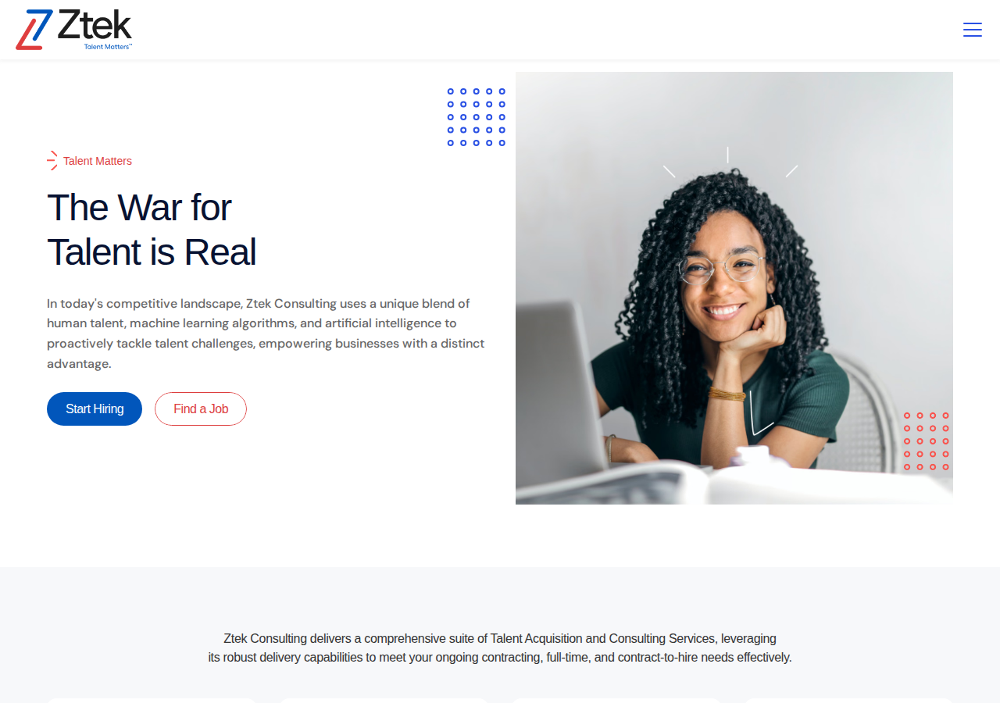
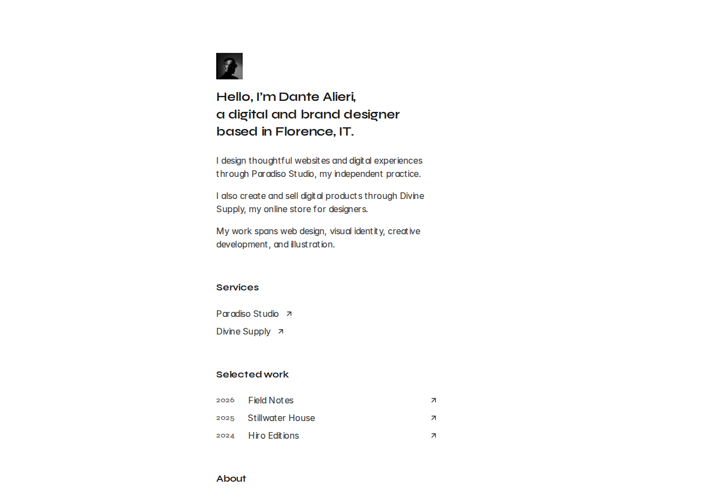
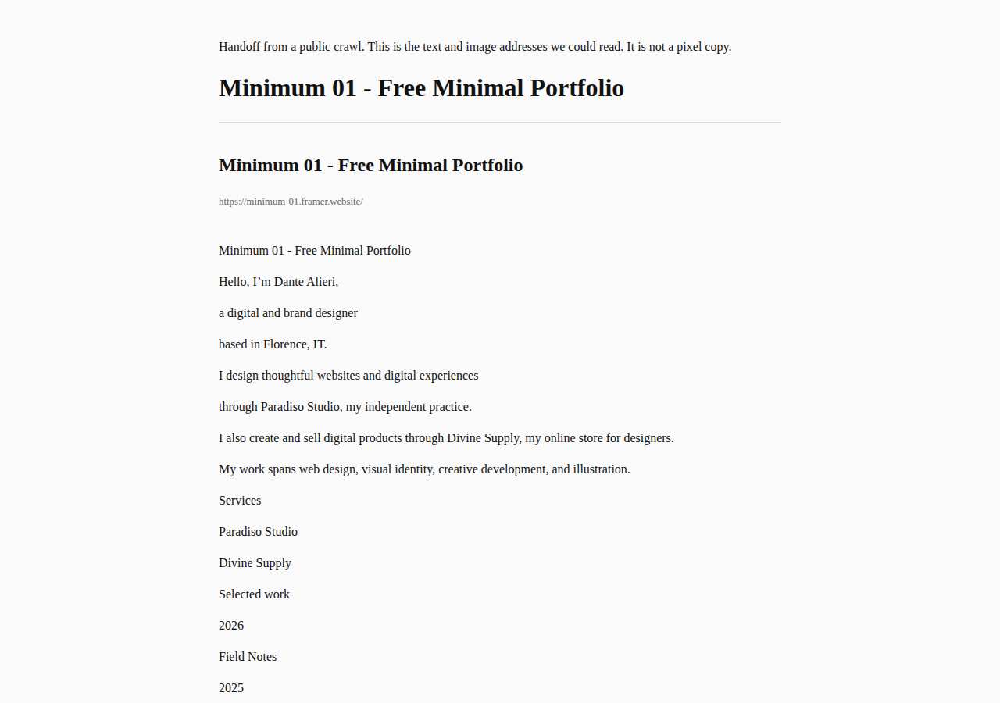
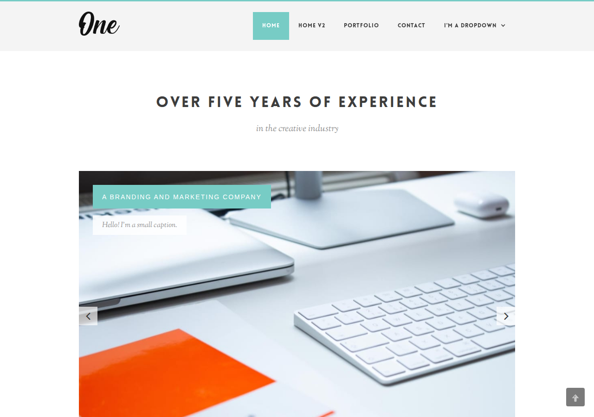
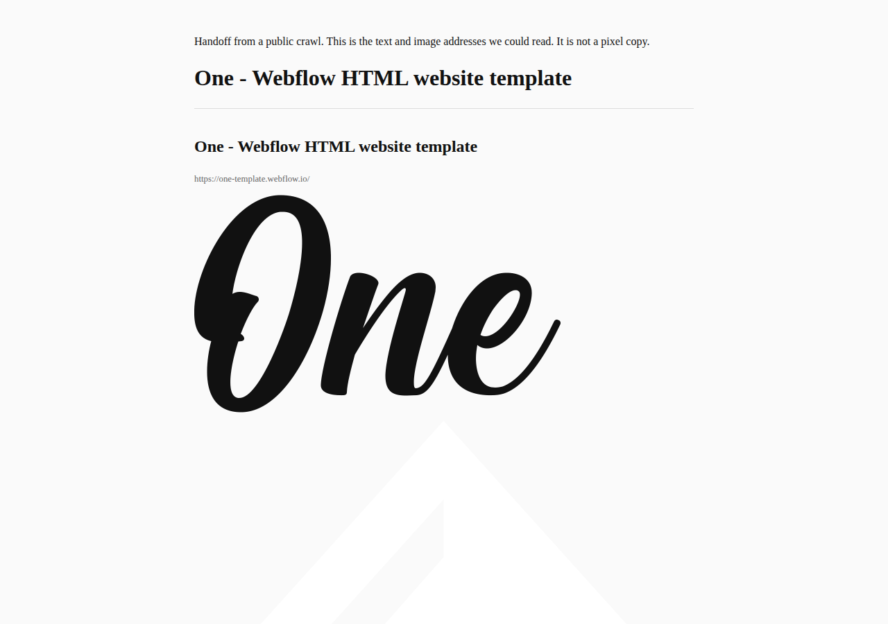
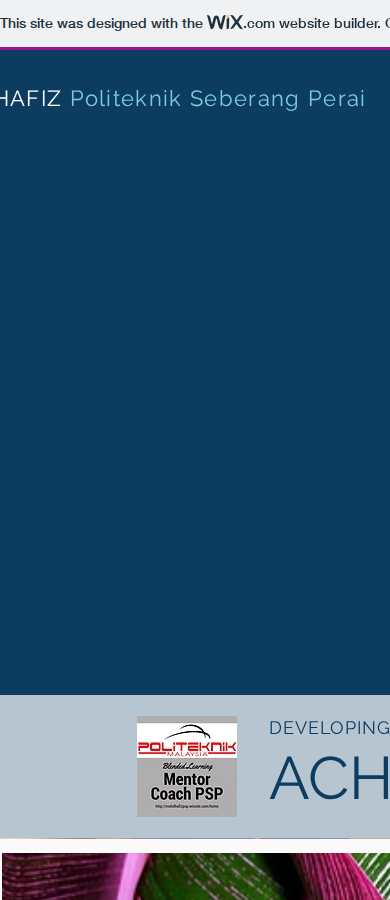
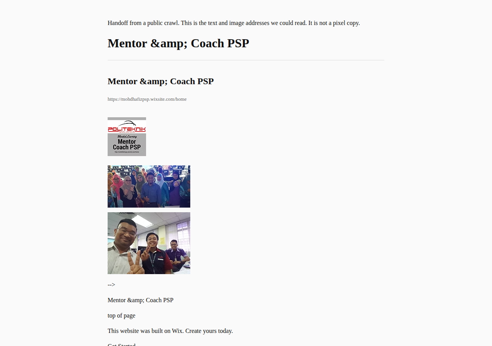
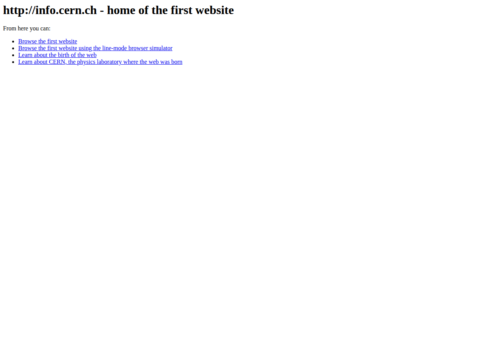
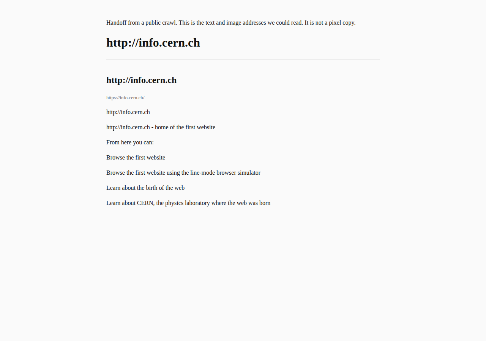

# Pipeline test, 2026-10-10

No `ANTHROPIC_API_KEY` was available, so `pnpm rebuild` was not run. The official rebuilder still stops without that key. For each site the production HTTP crawler (`lib/http-crawl.ts`) scored complexity, then a local handoff was written from the crawled HTML: visible text and image URLs, in `out/pipeline/<slug>/` (gitignored) as `index.html` and `app-page.tsx`. That handoff is a content extract. It is not a designed page.

Times below are one warm pass: crawl, score, write the handoff, then desktop and mobile screenshots. An earlier cold crawl of the Wix site took about 20 seconds before caches warmed.

Crawl filter added after the first pass: feeds, images, and other non-HTML responses are not counted as pages, and sitemap image URLs are not counted as pages. Re-scoring after that filter did not change eligibility for these five sites.

## Results

| Site | Platform | Eligible | Pages (crawled) | Assets | Pullable | Forms | Crawl | Score | Handoff | Screenshots | Total | Parity |
|---|---|---|---|---|---|---|---|---|---|---|---|---|
| [ztekinc.com](https://ztekinc.com) | Framer | No, add-on | 19 (16) | 32 | yes | 5 | 1.2s | 0.1s | 0.03s | 1.1s | 2.3s | Low |
| [minimum-01.framer.website](https://minimum-01.framer.website/) | Framer | Yes | 2 (2) | 2 | yes | 0 | 0.5s | 0.004s | 0.004s | 0.5s | 1.0s | Low |
| [one-template.webflow.io](https://one-template.webflow.io/) | Webflow | Yes | 6 (6) | 52 | yes | 1 | 0.4s | 0.003s | 0.004s | 1.2s | 1.6s | Low |
| [mohdhafizpsp.wixsite.com/home](https://mohdhafizpsp.wixsite.com/home) | Wix | No, add-on | 16 (16) | 176 | no | 1 | 1.3s | 0.2s | 0.03s | 2.5s | 4.1s | Low |
| [info.cern.ch](https://info.cern.ch) | Static HTML | Yes | 1 (1) | 0 | yes | 0 | 2.0s | 0.001s | 0.002s | 0.8s | 2.8s | Fair |

Estimated migration hours from the scorer: ztekinc 6.6, minimum-01 1.5, one-template 2.7, Wix 5.2, CERN 1.3. Those hours assume a person or a model rebuild, not the text extract above.

## What the score said

- **ztekinc.com.** Framer. 19 pages and 5 form tags, so the simple-site cap does not include it. Assets were readable. Animation signal: Framer. Referral: priced add-on or refer out.
- **minimum-01.** Framer portfolio, 2 pages, no form. Eligible. Animation signal is the platform itself, not a 3D scene.
- **one-template.** Webflow marketing template, 6 pages, 1 form. Eligible. Webflow interactions were detected.
- **Wix mentor site.** 16 pages and heavy JavaScript, plus Lottie. Not eligible. Asset sample was not treated as an easy pull.
- **info.cern.ch.** One static document. Eligible. No images.

## Visual parity

Parity is judged from desktop and mobile screenshots of the live site against the text handoff. None of the designed sites were reproduced.

- **ztekinc.** Original is a dark Framer marketing page with a hero, navigation, and photography. The handoff is a single column of extracted sentences and image URLs. Missing: layout, type, color, motion, and the real form. Rating: low.
- **minimum-01.** Original is a sparse portfolio (name, services, selected work). The handoff keeps that text and drops the type, spacing, and portrait treatment. Rating: low.
- **one-template.** Original is a multi-section Webflow template. The handoff stacks headings and some CDN images. The mobile screenshot of the live site was mostly empty at `DOMContentLoaded`, which is a capture limit, not proof the live page is blank. Rating: low.
- **Wix.** The live page is client-rendered. The screenshot at `DOMContentLoaded` does not show the designed layout. The handoff did recover page titles (About, Event, Performance Record) and `wixstatic.com` image URLs. Rating: low.
- **CERN.** The original is already a short unstyled document. The handoff repeats that text inside a plain page. Rating: fair, because there was little design to lose.

## Bugs fixed while testing

- The crawler followed XML feeds and could treat non-HTML responses as pages. It now keeps HTML documents and ignores sitemap image URLs when counting pages.
- The handoff escaped text that was already escaped, so titles rendered as `&amp;amp;`. Titles are decoded once before escaping.
- `pnpm rebuild` still requires `ANTHROPIC_API_KEY`. That step is blocked.

## Screenshots

### ztekinc.com

### minimum-01 (Framer)

### one-template (Webflow)

### Wix

### info.cern.ch

