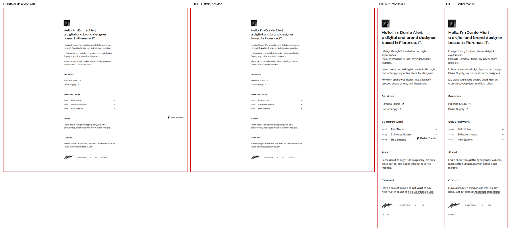
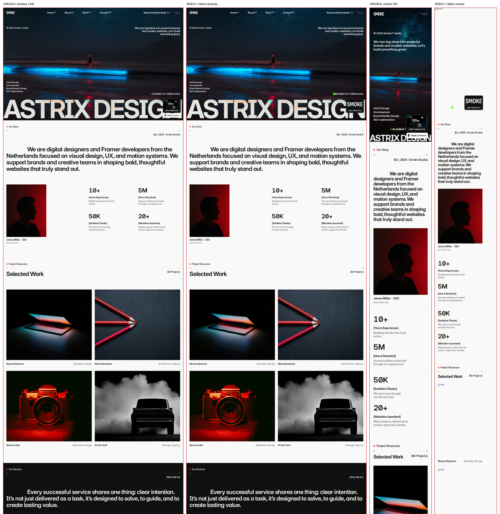
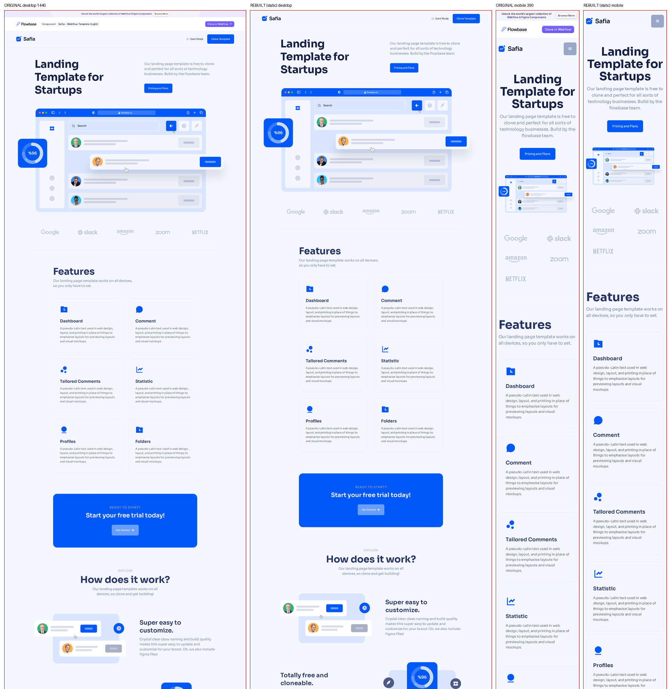
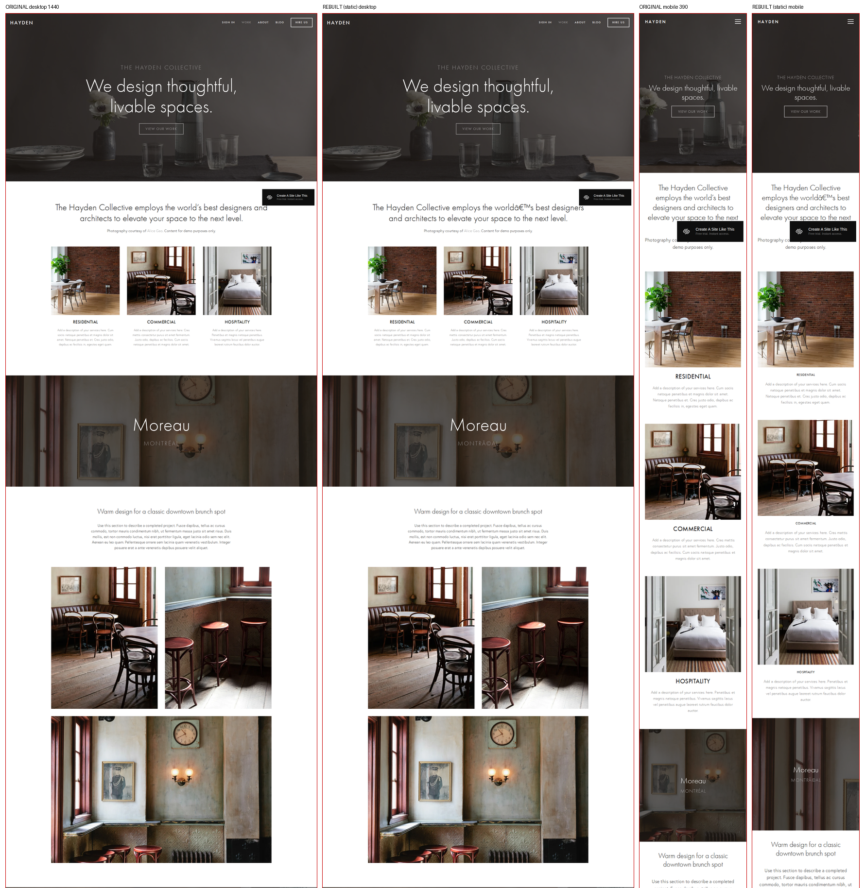

# Static move parity, 2026-10-12

No model and no paid API. Each site was crawled (robots.txt, about one document a second, path scoped, ztekinc limited to the ten pages from the 2026-10-10 run), then written as HTML, CSS, images, and fonts. The moved page was screenshotted with remote requests blocked, so a live CDN could not fill in a missing file. The High / Medium / Low rule is the one in `scripts/harness/compare.py`, unchanged from 2026-10-10.

**14 High, 2 Medium, 0 Low.**

The October 10 LLM rewrite was Low on both sites it finished. The no-model text handoff was Low on 15 of 16. On these same fixtures the captured page scores higher. The gap that remains is the phone layout when the platform builds it in script rather than in the CSS we kept, plus forms, video, and embeds.

Wall time below is crawl, static move, screenshot of the moved site, and compare. The live-site screenshot is included when it was not already on disk (a few seconds). Output size is the folder the customer would keep.

| Site | Platform | Pages | Rating | Edge-SSIM desktop | Edge-SSIM mobile | Text recall | Height desktop | Height mobile | Wall | Output |
|---|---|---|---|---|---|---|---|---|---|---|
| minimum-01 | Framer | 2 | High | 0.9948 | 0.9869 | 1.000 | 1.000 | 1.000 | 17.4s | 0.30 MB |
| photr | Framer | 10 | High | 0.9731 | 0.7754 | 1.000 | 1.000 | 1.000 | 83.4s | 11.93 MB |
| smoke | Framer | 6 | Medium | 0.9981 | 0.6337 | 1.000 | 1.000 | 1.739 | 78.4s | 6.37 MB |
| one-template | Webflow | 6 | High | 0.9996 | 0.6382 | 1.000 | 1.000 | 1.000 | 42.2s | 6.94 MB |
| clean-landing | Webflow | 2 | High | 0.9998 | 0.6232 | 1.000 | 1.000 | 0.842 | 35.5s | 1.92 MB |
| safia | Webflow | 1 | Medium | 0.5555 | 0.4109 | 1.000 | 0.981 | 0.986 | 33.5s | 5.61 MB |
| wix-daycare | Wix | 1 | High | 0.9736 | 0.9446 | 1.000 | 1.000 | 1.000 | 28.4s | 2.24 MB |
| wix-coachpro | Wix | 1 | High | 0.9808 | 0.9507 | 1.000 | 1.000 | 1.000 | 58.0s | 1.66 MB |
| wix-grove | Wix | 7 | High | 1.0000 | 0.7753 | 1.000 | 1.000 | 1.000 | 122.1s | 5.98 MB |
| sqsp-pacific | Squarespace | 2 | High | 0.9650 | 0.4674 | 1.000 | 1.000 | 1.002 | 69.6s | 2.69 MB |
| sqsp-hayden | Squarespace | 10 | High | 0.9959 | 0.2825 | 0.995 | 1.000 | 0.997 | 197.8s | 9.57 MB |
| static-html5up-phantom | Static (HTML5 UP) | 3 | High | 1.0000 | 0.9625 | 1.000 | 1.000 | 1.001 | 41.0s | 1.02 MB |
| static-cern | Static HTML | 1 | High | 0.9224 | 0.7704 | 1.000 | 1.000 | 1.000 | 12.8s | 0.01 MB |
| static-startbootstrap | Static (Bootstrap) | 1 | High | 0.8568 | 0.7893 | 1.000 | 1.000 | 1.004 | 27.1s | 2.56 MB |
| static-html5up | Static (HTML5 UP) | 1 | High | 0.9981 | 0.9987 | 1.000 | 1.000 | 1.000 | 21.2s | 1.16 MB |
| ztekinc | Framer | 10 | High | 0.9835 | 0.5085 | 1.000 | 1.000 | 0.996 | 82.1s | 4.96 MB |

Per-site JSON, including the short note on what breaks, is `docs/static-move/<slug>.json`.

The rating rule uses desktop edge-SSIM, text recall, desktop height, and mobile height. It does not threshold mobile edge-SSIM. Hayden (0.283), Pacific (0.467), and ztekinc (0.509) are High on the rule and weaker on the phone screenshot. Those mobile numbers are in the table on purpose.

## What breaks

- **Phone layout that is not in the CSS.** Smoke's desktop page matches and its mobile page is 1.74 times too tall. Squarespace mobile edge-SSIM is 0.47 and 0.28 even when the height matches. Wix matched the harness at 390px, and that harness uses a desktop user agent. Loading the live daycare site with an iPhone user agent produced a different document (scroll height 7611 vs 6497). That phone document is not in the static files.
- **The Flowbase bar, not the font files.** Safia was remeasured on 2026-10-13 after the crawl started saving font files named in CSS. Inter Regular, Medium, and Bold from `assets.flowbase.co` are local woff2 files, and no stylesheet still has a remote `url()`. Desktop edge-SSIM stayed 0.556 (fold 0.363). The page text uses Sora, which was already local. The Flowbase bar is an empty `div` in the captured HTML; the script that paints it is removed, so the bar is missing from the moved shot. Illustrations are local SVGs.
- **Forms.** Flagged `data-eject-form="needs-endpoint"`. The captured action is replaced with `#` and native submit is blocked, so visitor data does not post to the previous host. Counts are in the per-site JSON (one on most brochure templates, five on Hayden, twelve on ztekinc).
- **Video and embeds.** The daycare template has a video element that still points at Wix. Hayden embeds Acuity. Those hosts were blocked in the moved-site screenshot.
- **Menus and entrance motion.** Platform scripts are removed. A Webflow hamburger stays closed. The closed header is what both screenshots show, so the score does not punish it. Entrance animations that waited for the runtime are flattened so the page stays visible.
- **HTML5 UP and Bootstrap.** The resting layout matches. Their small scripts (menu toggle, navbar collapse) are gone.

## Delivery gate

The gate is two of three simple sites at Medium or better, with hand polish that fits in 90 minutes. Hand polish was not timed.

The October 10 scorer called these eligible and easy: minimum-01, photr, smoke, one-template, clean-landing, safia, wix-daycare, wix-coachpro. This run: **6 High, 2 Medium, 0 Low.** All eight are Medium or better. The parity half of the gate is met for simple Framer, Webflow, and Wix brochure pages.

Squarespace was outside that easy set. Both Squarespace demos are High on the rule and weak on mobile edge-SSIM. Static pages are High. ztekinc is High on the desktop rule and was not a simple-site job (too many forms).

A High simple page still needs a form endpoint and a look at the menu. Smoke's mobile layout is the simple site that still needs a real layout pass. That is the difference between "the page is already there" and "rebuild it."

## Side by side

Original on the left, static move on the right. Desktop 1440, then mobile 390. The moved shot had no network except the local server.

### minimum-01 (Framer, High)

### smoke (Framer, Medium)

Desktop matches. The mobile page runs long.

### safia (Webflow, Medium)

Same text and almost the same height. Inter is local. The Flowbase bar at the bottom is missing because the script that paints it is gone. Desktop edge-SSIM stayed 0.556.

### sqsp-hayden (Squarespace, High on the rule)

Desktop matches. Mobile edge-SSIM is 0.283.

## Samples

Three of the moved sites are on an unlisted path, `/samples`, with `noindex` and no sitemap entry. Marketing pages are unchanged.

- `/samples/minimum-01/`
- `/samples/clean-landing/`
- `/samples/wix-coachpro/`
